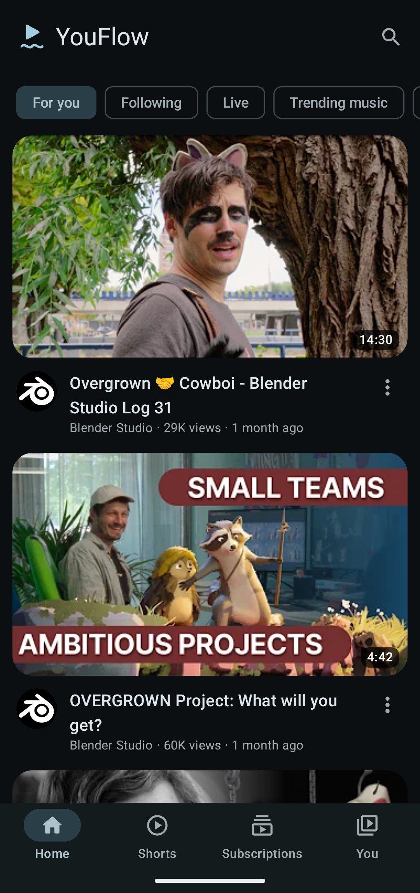
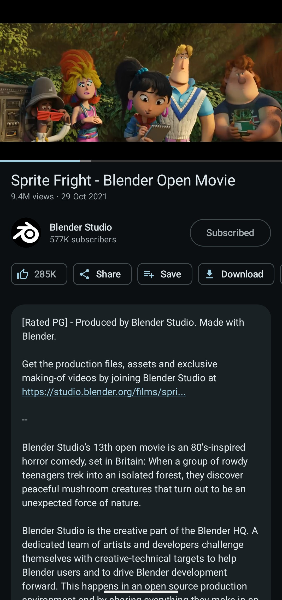
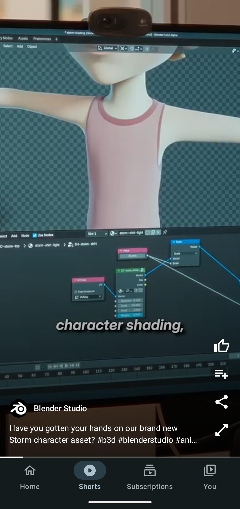

# YouFlow

A free, private YouTube client for Android with a Material 3 Expressive interface. No ads, no
account, no Google services. YouFlow is a fork of [NewPipe](https://github.com/TeamNewPipe/NewPipe):
the YouTube parsing comes from [NewPipeExtractor](https://github.com/TeamNewPipe/NewPipeExtractor),
the screens and the player are new.

<p>
  
  
  
</p>

[Watch the 30 second demo](docs/media/youflow-demo.mp4) (home, player, downloads, Shorts).

YouFlow is source only: there is no APK to download. You build it on your computer and install it on
your phone over USB, which takes about 20 minutes the first time. Steps are in
[Build and install](#build-and-install).

YouFlow is not affiliated with YouTube, Google, NewPipe, TeamNewPipe or NewPipe e.V. and does not use
their name or branding. Videos on the screenshots are from
[Blender Studio](https://studio.blender.org) (CC BY).

## Features

- Home with a local "For you" feed built on the device from your history, likes and subscriptions
- Shorts feed with preloading, likes, saving and sharing
- Search, channels, playlists, comments, chapters, captions
- Subscriptions without an account, feed groups, import and export (NewPipe backups work)
- Background play, picture in picture, mini player, audio-only mode, sleep timer, queue
- Downloads
- Local history, watch later and playlists
- A reorderable bottom bar, with Shorts optional
- No Google services, no ads, no tracking, no account. Nothing leaves the device except the requests
  YouTube itself needs.

Android 12 (API 31) or newer. English only.

## Build and install

You need a computer (Windows, macOS or Linux) with about 10 GB free, an Android 12 or newer phone, and
a USB cable.

### 1. Install the tools

- **JDK 17 and JDK 21**, both. The app builds with Java 21 and NewPipeExtractor with Java 17, and
  Gradle does not download them for you. Get Temurin
  [17](https://adoptium.net/temurin/releases/?version=17) and
  [21](https://adoptium.net/temurin/releases/?version=21) from adoptium.net (macOS with Homebrew:
  `brew install --cask temurin@17 temurin@21`; Debian or Ubuntu:
  `sudo apt install openjdk-17-jdk openjdk-21-jdk`). With one missing, the build stops with
  "Cannot find a Java installation on your machine matching languageVersion=21" (or 17).
- **Android Studio** from [developer.android.com/studio](https://developer.android.com/studio), which
  brings the Android SDK. (If you only want the terminal, the Android SDK command-line tools work too.)
- **Git**, from [git-scm.com](https://git-scm.com/downloads) if you do not have it.

### 2. Get the code

NewPipeExtractor is a git submodule, so clone with `--recurse-submodules`:

```
git clone --recurse-submodules https://github.com/jordan-jakisa/YouFlow
```

If you already cloned without it, run `git submodule update --init` inside the folder.

### 3. Get your phone ready

1. On the phone, open Settings, About phone, and tap **Build number** seven times. Developer options
   are now on.
2. Open Settings, System, Developer options, and turn on **USB debugging**.
3. Plug the phone into the computer and tap **Allow** on the "Allow USB debugging?" prompt.

### 4. Build and install

**With Android Studio:** open the `YouFlow` folder (File, Open), wait for the Gradle sync to finish
(the first one downloads a lot), pick your phone in the device list at the top, and press **Run**.

**From a terminal:** tell Gradle where the Android SDK is (Android Studio shows the path in Settings,
Languages and Frameworks, Android SDK), then build and install:

```
cd YouFlow
export ANDROID_HOME="$HOME/Library/Android/sdk"   # macOS; on Linux usually $HOME/Android/Sdk
./gradlew installContinuous                       # Windows: gradlew.bat installContinuous
```

Both install the optimised build (minified like a release, signed with your own debug key). It
shows up on the phone as **YouFlow Continuous**. To update later, `git pull`,
`git submodule update`, and run the same step again; your data stays.

### Installing without USB

`./gradlew assembleContinuous` writes `app/build/outputs/apk/continuous/app-continuous.apk`, which you
can copy to the phone and open. From 2027 Google adds a check for apps from unregistered developers on
certified phones, and YouFlow is not registered. Copied APKs then need Android's one-time "advanced
flow" (Developer options, a one-day wait, then "Install Anyway"). Installing over USB as above is not
affected. Details: [docs/developer-verification.md](docs/developer-verification.md).

### For developers

```
./gradlew testDebugUnitTest      # unit tests
./gradlew :app:runKtlint         # style check (:app:formatKtlint fixes it)
```

The design and scope are written up in [docs/spec/youtube-client-spec.md](docs/spec/youtube-client-spec.md).
Notes for publishing on F-Droid are in [docs/fdroid/README.md](docs/fdroid/README.md).

## Credits

- [NewPipe](https://github.com/TeamNewPipe/NewPipe) by the NewPipe contributors, which this project
  is forked from.
- [NewPipeExtractor](https://github.com/TeamNewPipe/NewPipeExtractor), which does all the YouTube
  parsing.
- AndroidX, Jetpack Compose, Media3, Room, OkHttp, Coil, RxJava and the other open-source libraries
  listed in `gradle/libs.versions.toml`.

## License

Free software under the GNU General Public License, version 3 or (at your option) any later
version. See [LICENSE](LICENSE). Copyright is held by the NewPipe contributors and by the authors of
this fork, as recorded in the file headers and the git history. This program is distributed in the
hope that it will be useful, but WITHOUT ANY WARRANTY, without even the implied warranty of
MERCHANTABILITY or FITNESS FOR A PARTICULAR PURPOSE.
